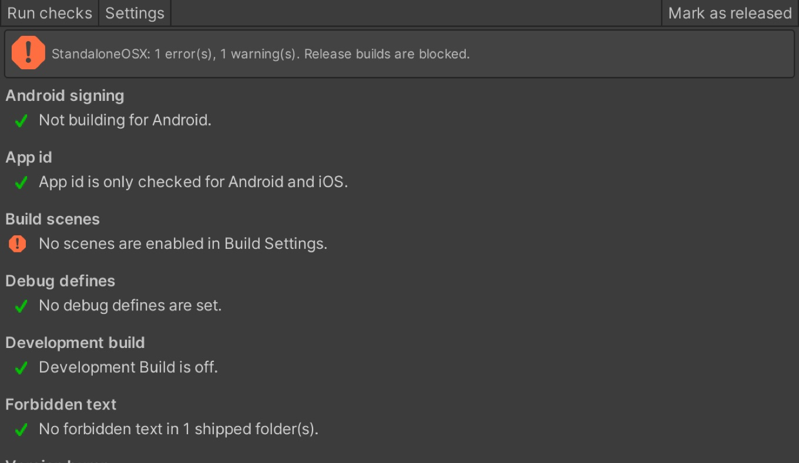
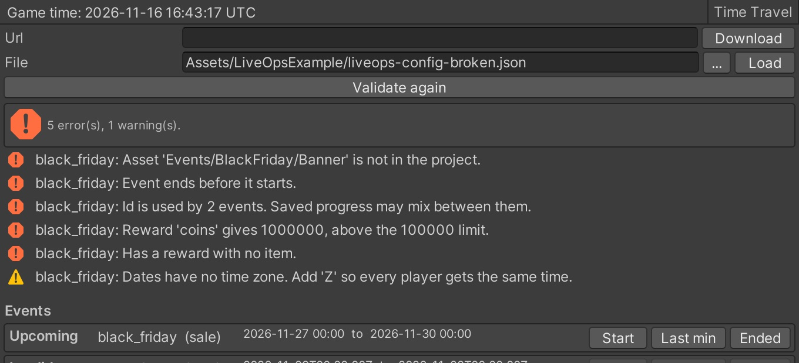
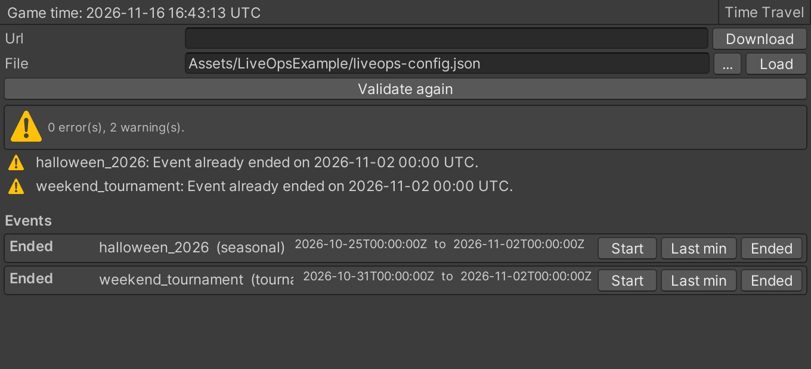
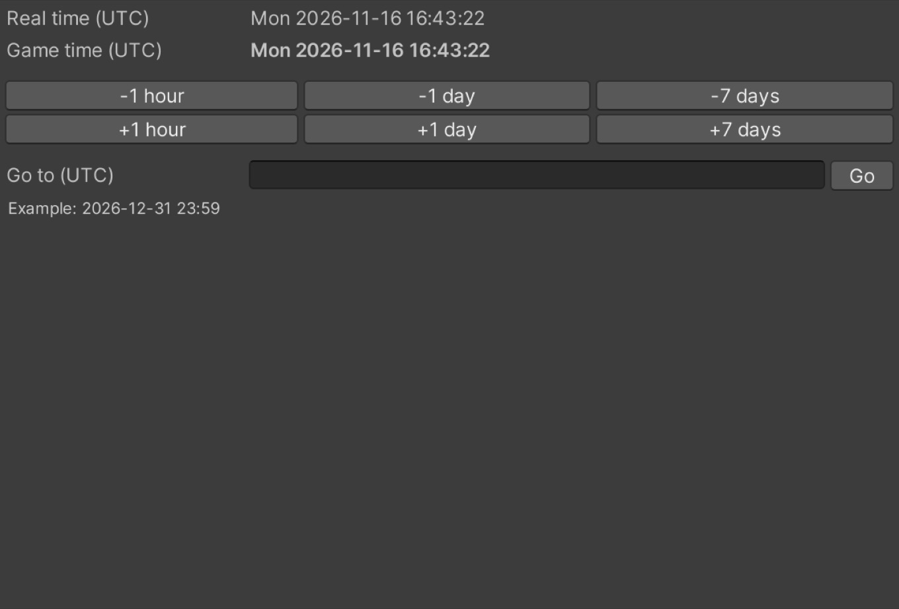

<!-- showcase-header -->
<div align="center">

<h1>LiveOpsKit</h1>

<p><b>Unity Editor tools that catch the mistakes that break a live game before players see them.</b></p>

  

<p><a href="https://abhinandand91-debug.github.io/">Portfolio</a></p>

<p>&nbsp;</p>
<p>&nbsp;</p>
<sub>Captured from the three tool windows in the Unity Editor, using the package's sample configs.</sub>

</div>

---

<!-- /showcase-header -->
## About

Unity editor tools that catch the mistakes that usually break a live game, before players see them.

| Tool | What it stops |
|---|---|
| **Release Checker** | Shipping a development build, cheat defines, a staging url, the debug keystore, the wrong app id or a version that was not bumped. |
| **LiveOps Config** | Shipping an event config with broken dates, missing time zones, duplicate ids, missing assets or a reward with an extra zero. |
| **Time Travel** | Not testing what happens when an event starts, is in its last minute, or ends. |

Works with Unity 2022.3 and Unity 6. No dependencies.

### Install

In Unity, open **Window > Package Manager > + > Add package from git URL** and paste:

```
https://github.com/abhinandand91-debug/LiveOpsKit.git
```

All tools are under **Tools > LiveOpsKit**.

### Release Checker

Open **Tools > LiveOpsKit > Release Checker**. It runs every check for the current build target and shows a **Fix** button where a one-click fix is safe.

Checks included:

- **Development build**: Development Build, Autoconnect Profiler and Script Debugging are off.
- **Debug defines**: no `DEBUG_MENU`, `CHEATS`, `ENABLE_CHEATS` or your own forbidden defines.
- **App id**: matches the store id you set in Release Settings.
- **Version bump**: version and bundle code / build number are higher than the last release.
- **Android signing**: a release keystore and alias are set.
- **Build scenes**: the scene list is not empty and every scene file exists.
- **Forbidden text**: no `staging.`, `localhost` or `"testMode": true` in any `Resources` folder or in `StreamingAssets`.

**Build gate**: once the Release Settings asset exists, every release build runs the checks first. Any error stops the build. Development builds are never blocked.

After you ship, press **Mark as released** so the next build must bump its version.

Settings live in `Assets/LiveOpsKit/ReleaseSettings.asset`.

#### Add your own check

Subclass `ReleaseCheck` anywhere in an editor folder. It is picked up automatically.

```csharp
public class AdsTestModeCheck : ReleaseCheck
{
    public override string Name => "Ads";

    public override IEnumerable<CheckResult> Run(ReleaseSettings settings)
    {
        if (MyAdsConfig.TestMode) yield return CheckResult.Error("Ads are in test mode.");
        else yield return CheckResult.Pass("Ads are live.");
    }
}
```

### LiveOps Config

Open **Tools > LiveOpsKit > LiveOps Config**. Paste your config url and press **Download**, or pick a local json file.

The config format:

```json
{
  "version": 12,
  "events": [
    {
      "id": "halloween_2026",
      "type": "seasonal",
      "startUtc": "2026-10-25T00:00:00Z",
      "endUtc": "2026-11-02T00:00:00Z",
      "assets": [ "Events/Halloween/Banner" ],
      "rewards": [ { "item": "coins", "amount": 5000 } ]
    }
  ]
}
```

Rules included:

- Every event has a unique id.
- Dates parse, include a time zone (`Z`), end after they start and are not longer than the limit.
- Events of the same type do not overlap.
- Asset paths exist, either as `Assets/...` paths or as `Resources` paths.
- Rewards have an item and an amount between 1 and the limit.

Each event shows its state at game time (Upcoming, Live, Ended) with buttons to jump game time to its **Start**, **Last min** or **Ended**.

Add your own rule by subclassing `ConfigRule`.

### Time Travel

Read time through `LiveOpsClock` instead of `DateTime.UtcNow`:

```csharp
if (myEvent.IsLive) ShowBanner();
var resetAt = LiveOpsClock.UtcNow.Date.AddDays(1);
```

Then open **Tools > LiveOpsKit > Time Travel** to move game time by hours or days, or to a date. The offset is saved, so it survives play mode and app restarts.

Time travel only works in the editor and development builds. Release builds always use real time.

### Samples

Import **LiveOps Example** from the Package Manager to get a clean config, a broken config to see the validator at work, and an `EventBanner` script.

### License

MIT
